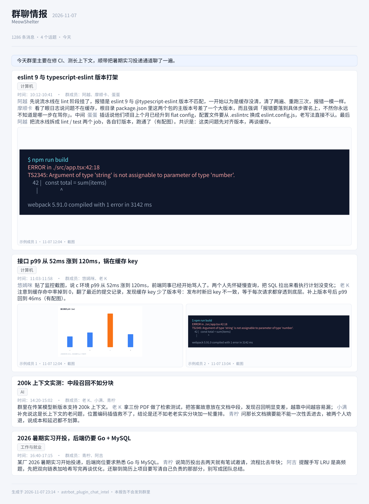
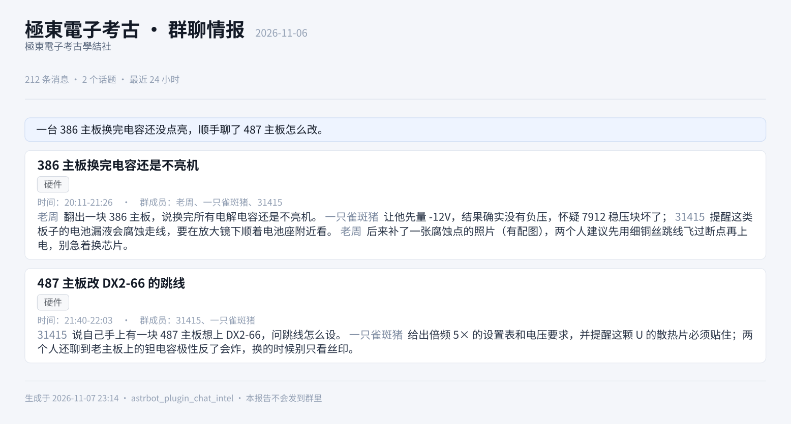
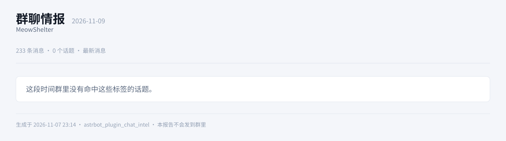

<p align="center">
  
</p>

<h1 align="center">群聊情报（astrbot_plugin_chat_intel）</h1>

<p align="center">每个群一份标签清单，把群友真聊出来的话题整理成一张长图，私聊发给你。</p>

同一个机器人可能挂了好几个群，而每个群聊的东西完全不一样：一个群在焊板子、翻老硬件手册，另一个群在修 CI、聊模型评测。
所以标签是**一群一份**的：每个群写自己的「关心的标签 / 不要的标签」。

标签只当**筛子**，不当作分节标题：报告的一节 = 群友这段时间**自己聊出来的一个话题**
（谁先提起、怎么聊下去、最后什么结论），标签决定哪些话题值得收。
不符合标签的闲聊、灌水、表情一律不进报告。报告**只落盘 + 私聊投递，永不发回群里**。

## 样张

话题卡：标题、标签、时间、参与人，加一段讲得完整的事件经过；正文里的群友昵称排成浅一点的色，跟描述文字分开，标签只是中性色的圆角小框：



同一个插件、另一个群、另一套标签（复古硬件），话题少而深：



这天没有命中任何标签（不硬凑，直接给空状态）：



## 它做什么

1. **采集**：机器人常驻群里，收到群消息就落盘（文本 + 图片）。**采集与禁言解耦**：
   只要群号写进配置就会记录，跟这个账号说不说话、由哪个账号收到都无关
2. **归话题**：每个群一次 LLM 调用，带着**这个群自己的** `tags_pos / tags_neg` 读记录，
   让模型把记录切成一个个话题：给标题、标签、引用的消息编号、以及一段完整讲述
3. **算时间与成员**：时间范围和参与人由程序按模型引用的消息编号回查原始记录算出来，
   不信模型自己写的时间和人名；没打上正向标签的话题直接丢掉
4. **排版**：本地 [Typst](https://typst.app) 编译成一张长图，不依赖任何远程渲染服务
5. **话题配图**：群里的图片当场下载转存（QQ 图片链接有时效），生成时**图跟着话题走**——只挑这个话题自己引用到的消息里的图，先让视觉模型按标签判一遍，每个话题最多放 `max_images` 张
6. **投递**：图片写入插件数据目录，到点私聊推送；**群里零响应**
7. **静默通道**（可选）：让承载它的账号在任何群、任何私聊里都不开口——用「只读机器人号挂着群」时不暴露

## 安装

### 1. 插件本体

```bash
cd <AstrBot>/data/plugins
git clone https://github.com/Blue-radish/astrbot_plugin_chat_intel
```

然后在 WebUI 的「插件管理」里重载，或在配置里启用。

### 2. 依赖

```bash
pip install typst
```

Typst 是本地排版引擎，`pip install` 即可，无需额外运行时（不依赖浏览器、不依赖 LaTeX）。

### 3. 中文字体

报告模板优先使用 **Noto Sans SC**。把字体文件放进：

```
<AstrBot>/data/plugin_data/astrbot_plugin_chat_intel/fonts/
```

至少放一个中文字体（`NotoSansSC.ttf` 或任何 `Source Han Sans` / `Microsoft YaHei` 均可），
否则中文会显示成方框。模板的字体回退顺序是：
`Noto Sans SC → Source Han Sans SC → Microsoft YaHei → PingFang SC → Inter`，
所以 Windows / macOS 上即使不装 Noto 也能正常显示。

## 配置

在 WebUI 的插件配置页填写（也可以直接改 `data/config/astrbot_plugin_chat_intel_config.json`）。

### 要总结的群（一群一行）

| 字段 | 说明 | 默认 |
|---|---|---|
| `群号` (`gid`) | 群号（必填） | 空 |
| `读取账号` (`platform`) | 这个群优先用哪个 bot 去读历史；留空用全局「默认读取账号」 | 空 |
| `群名备注` (`name`) | 留空自动检测 | 空 |
| `报告标题` (`title`) | 这个群的报告标题；留空用全局 `report_title` | 空 |
| `关心的标签` (`tags_pos`) | 一行一个（或逗号分隔），比如 `电脑`、`动漫`、`科研` | 空 |
| `不要的标签` (`tags_neg`) | 一行一个，沾上就不写进报告 | 空 |

`tags_pos` 写不写决定这个群有没有报告：**没配标签的群会被跳过**，并私聊提醒你一次。

标签是筛子，不是标题：一个话题至少要命中一个正向标签才会进报告，报告里的话题标题由模型按实际情况写。
标签写得具体一点更准（`本地部署大模型` 比 `AI` 好，`复古硬件维修` 比 `科技` 好）。
宽泛标签的后果不是漏报，而是把不相干的闲聊也放进来。

同一个群号写两行时只认第一行，其余忽略并写日志。

**手改 JSON 的话**每行要带 `"__template_key": "chat"`：界面靠这个字段知道该用哪个模板渲染，
少了它这一栏会显示「未指定模板 / 找不到对应模板」。在界面上点「添加条目」加出来的行会自动带上。

### 全局项

| 配置项 | 说明 | 默认 |
|---|---|---|
| `platform_id` | 默认读取账号：某群没写 `platform` 时用它 | 空 |
| `days` | 首次生成（还没有上次记录）时回溯多少天 | `1.0` |
| `max_messages` | 单群单次最多处理多少条 | `10000` |
| `use_local_store` | 本地累积群消息（强烈建议开） | `true` |
| `include_images` | 保存图片并挑进报告 | `true` |
| `max_images` | 每个话题最多放几张图 | `4` |
| `max_image_mb` | 单图大小上限，超过丢弃 | `8` |
| `keep_days` | 本地消息与图片保留天数 | `7` |
| `daily_time` | 每天自动生成时间 `HH:MM`，每次总结**过去 24 小时**；留空则不定时 | `23:00` |
| `push_enabled` | 生成后自动私聊推送 | `false` |
| `push_umo` | 推送目标会话 `<平台id>:FriendMessage:<QQ号>` | 空 |
| `report_title` | 默认报告标题 | `群聊情报` |
| `render_ppi` | 出图清晰度 | `180` |
| `owner_uids` | 允许触发本插件的 QQ 号（私聊）。**留空 = 谁都不给用**，见下方「谁能拉报告」 | 空 |
| `ignore_uids` | 不统计的 QQ 号（一般填机器人自己） | 空 |
| `silence_platforms` | 要静音的账号，逗号分隔。留空 = 不静音任何人（读历史账号不会自动静音） | 空 |

模型不用配：总结用 AstrBot 当前的默认对话模型；判图时如果默认模型不能读图，会自动翻一遍所有
供应商，挑一个声明支持图片输入的来判，一个都没有就退回「尺寸 + 上下文文字」的规则筛选。
字体也不用配：插件自带 `data/plugin_data/astrbot_plugin_chat_intel/fonts/`。

`push_umo` 的格式是 `<平台实例id>:FriendMessage:<QQ号>`，比如机器人平台实例叫 `mybot`、你的 QQ 是 `10001`，
就填 `mybot:FriendMessage:10001`。

发送前会**严格校验**这个字符串：必须是三段、消息类型必须是私聊（`GroupMessage` / `Other` 这类一律拒绝）、
收件人必须是数字 QQ 号。任何一项不对就**不发**，并在日志里写清原因——报告永远只走私聊。

### 谁能拉报告（`owner_uids`）

`owner_uids` 是唯一的准入名单：只有这些人私聊机器人时，插件才会生成、重发、报状态。

- **留空 = 谁都不能用**（fail-closed）。群聊内容不是公开内容，默认不该对所有能给机器人发私聊的人开放
- 留空时有人来要报告，插件只回一条「去 WebUI 填 owner_uids」的提示（同一小时最多一次），不会生成
- 想加号就填逗号分隔的 QQ 号；这个名单只管「谁能主动查」，管不到自动推送到哪（那是 `push_umo`）

### 静默与「读历史账号」是两件事

`platform_id` / 每群的 `platform` 只是**用哪个号去读历史**，它**不会**把这个号静音。
要静音必须显式写进 `silence_platforms`。

`silence_platforms` 里列的账号：不发消息、不过 LLM、不发任何回复，但**照常采集数据**。
所以「大号在群里当耳朵（禁言）+ 小号负责送报」是正常用法，禁言不会漏数据。

早先版本里 `silence_platforms` 留空会自动把 `platform_id` 一起静音，这是个隐蔽的坑（改个读取账号，
顺手把整个账号在别的插件里也弄哑了），现在取消了：不填就是谁都不静音。

两个 bot 同时在一个群时，同一条消息会被写两遍，读取时按 `(发送者, 秒级时间, 文本)` 指纹去重，
不按平台整表过滤（整表过滤会漏掉只有一个 bot 收到的时段）。

## 触发方式（没有命令）

**这个插件没有任何命令入口**，全部靠自然语言。它所在的那个机器人同时还管人设闲聊、B站推送、TTS，
所以**任何意图都必须同时命中「指向词」和「动作词」**才认，光有动作词不算，避免抢别人的话。

| 意图 | 指向词（必须含其一） | 动作词（必须含其一） | 例子 |
|---|---|---|---|
| 总结 | 情报 / 日报 / 群聊 / 群聊总结 / 聊天记录 | 总结 / 聊了啥 / 讨论了什么 / 有什么 / 跑一份 | 「群聊总结今天极东群聊了啥」 |
| 重跑 | 情报 / 日报 / 群聊总结 | 重跑 / 重新 / 再看一遍 | 「群聊情报把今天的重跑一遍」 |
| 状态 | **情报 / 情报系统 / 日报** | 状态 / 情况 / 正常吗 / 采集 | 「群聊情报系统现在什么状态」 |
| 重发 | 情报 / 日报 | 重发 / 再发 / 上一份 | 「群聊情报把上一份再发我」 |

- **状态**和**重发**要求强指向，因为「什么情况」「再发我」单独说时几乎肯定是别的功能在对话
- 「插件」**不算**指向词：B站推送、TTS 也是插件，「B站推送插件什么情况」不该被这里抢走
- **总结**允许「群聊 / 聊天记录」这种泛指，但还要同时带时间词或群名，且动作词必须是
  「总结 / 聊了啥 / 讨论了什么 / 跑一份」这类明确说法；「有什么」这种泛动作词只配强指向词认
  （「群里今天聊了啥」触发，「群里今天有什么好玩的」不触发）
- 没命中 → 插件完全不介入，交给机器人原本的功能
- 每次判定都写日志：命中哪条意图、范围、群、原文，便于事后调词
- 忙的时候（上一份还在生成）新请求会**排队**（最多再排两份），不会丢；队列也满了会明说跑不过来
- **点名了群却对不上**（比如把 `MeowShelter` 打成 `Slack`）：直接回「没找到这个群」并列出现在配了哪些群，
  不会悄悄退回「全部群」白跑一遍烧 token。只说了范围没提群，才是全部群

时间说法（今天/昨天/前天/大前天/N天前/最近N天/本周/上周/2026-11-05/2026年11月5日/11月5日）
和群名片段（含简繁归一，`极东` 能匹配 `極東電子考古學結社`，启动时会预热群名）都由规则直接认出，
不花模型调用；规则认不出的碎片才问一次模型（`smart_parse` 可关）。

没命中意图时还有一层兜底：插件注册了 LLM 工具 `group_digest`（参数 `when` / `group` / `again`），
模型自己决定要不要调；工具入口会再看一眼用户原话里有没有「总结 / 日报 / 聊了啥 / 情报」这类线索，
只是随口问「群里有什么好玩的」不会跑。**安全边界**：仅私聊、仅 `owner_uids`（名单为空则一律拒绝），
群里永不生成永不发送，`push_umo` 若不是合法的私聊会话会直接拒发。

不带时间参数就是「增量」：第一次跑回溯 `days` 天，之后每次只补上次之后的新消息。
「重跑」忽略该群的增量位，按解析出的范围重新总结一次。

**定时档不算增量**：设了 `daily_time = 23:00`，每天 23:00 汇总的是「昨天 23:00 到现在」这一整段，
和上一次跑到哪无关——漏跑一天也不会有缺口。

## 报告长什么样

```
群聊情报   2026-11-07 · MeowShelter
958 条消息 · 10 个话题 · 今天                       ← 透明度行
────────────────────────────────
[头条一句话：这段时间群里主要在聊什么]
┌──────────────────────────────────────────────┐
│ 200MB galgame 为何能玩二三十小时               │  ← 话题标题（模型按实际情况写）
│ ⌜计算机⌟  ⌜硬件⌟                              │  ← 命中的标签，中性色圆角小框
│ 时间：12:53-13:03 · 群成员：瓜子、崽咕咕、…      │  ← 程序按引用编号算出来
│ 瓜子 先问「我一直好奇，这 200mb 的游戏为什么…」  │  ← 昵称排成浅色，直接点名
│ 崽咕咕 回「马里奥没有资源啊」，又补「也不代表…」 │  ← 完整讲述：起因→经过→结论
└──────────────────────────────────────────────┘
（…更多话题卡…）
（图直接排在这个话题卡的正文下面，最多 `max_images` 张）
```

正文口径：**直接写群友昵称**（浅色显示），不用「有群友提到」「有人」这类模糊说法；
**贴原文写**，重要的话、数字、型号、报错、链接照抄，长话题写到 300-600 字，不做摘要式压缩。

透明度行的口径：**消息总数** = 该群这段时间落盘记录数（含只有图片/表情的）；
**话题数** = 命中标签、真的写进报告的话题个数。话题不设条数上限：有价值的全列，
所以话题特别多的日子图会很高——这是有意的取舍，宁可长也不漏。

## 数据保留

本地只留最近 `keep_days` 天（默认 7）：

```
data/plugin_data/astrbot_plugin_chat_intel/
├── messages/2026-11-07.jsonl   # 按天的原始消息（含图片相对路径、采集平台）
├── images/2026-11-07/xxxx.jpg  # 图片本体，按天分目录
├── reports/chat_intel_*.png    # 生成的报告
├── fonts/                      # 中文字体
└── state.json                  # 每个群上次覆盖到的时间戳 + 判图缓存
```

超过 `keep_days` 的消息文件、图片目录、旧报告会在启动时和每次生成后被删掉，
判图缓存里对应的条目也一起清。7 天的数据大约几十 MB。

## 为什么要「本地累积」

多数 OneBot 实现（NapCat / SnowLuma 等）的 `get_group_msg_history` 一次只返回最近约 200 条，且
`message_seq` 参数不一定支持翻页。实测 SnowLuma：`count` 上限 200，
`message_seq` / `message_id` / `start_message_id` / `anchor` / `before` 五种传法都拿回同一页——
想覆盖一整天，靠历史接口是不够的。

所以本插件在事件入口把配置里那些群的每条消息写到 `messages/YYYY-MM-DD.jsonl`，
生成时把「本地库 + 历史接口兜底」合并去重。机器人 24 小时在线，就能拿到完整一天的聊天。

代价是：**首次安装的当天只能覆盖最近 200 条**，第二天起才是完整一天。

## 图片怎么挑

QQ 的图片链接带临时签名，几个小时后就失效，所以插件**收到消息时就把图下载转存**（限宽 1200px，
超过 `max_image_mb` 的丢弃）。判图用的提示词同样是**这个群的兴趣清单**：报错/代码/终端截图、
电路图、原理图、器件照片、数据图表、说明书扫描件留下；表情包、自拍、宠物、吃喝、糊图一律不留。

判定结果按 `兴趣指纹 + 图片文件名` 缓存在 `state.json`，同一张图在同一兴趣下不会重复问模型；
改了兴趣就会重新判。

模型不支持图片输入时（`modalities` 里没有 `image`），退回规则筛选：小于 500×500 或接近正方形的一律
当表情包，本条消息要带「报错/日志/代码/部署/接口」这类词或链接才算数，最后再让模型看上下文做减法。
规则模式更保守，漏图但不会放梗图。

## 两个账号怎么配合

| 账号 | 角色 | 配置位置 | 说明 |
|---|---|---|---|
| 大号 | 在群里当耳目 | 每群 `platform`（或全局 `platform_id`），并写进 `silence_platforms` | 拉历史、查群名、**从不说话**，但照常采集 |
| 小号 | 送报童 | 出现在 `push_umo` 里 | 把报告私聊发给你，也负责回应你的话 |

私聊对你说话的那个号回你，群里始终看不到任何动静。

## 隐私与安全

- 报告**只落盘 + 私聊投递**，代码里没有任何「发回被总结的群」的路径；`push_umo` 非私聊格式直接拒发
- `owner_uids` 为空时一律拒绝（fail-closed），不会因为「忘了配」而对所有人开放
- 静默通道三层拦截（事件终止 / LLM 请求拦截 / 回复内容清空）
- 状态、重发这类敏感意图要求强指向词，闲聊不会被劫持
- 消息库只存文本与你配置的群，路径在插件自己的数据目录，删目录即清空

## 已知限制

- 需要机器人账号**在目标群里且长期在线**，离线期间的消息只能靠 200 条历史兜底补
- 依赖 OneBot v11 实现提供的 `get_group_msg_history` / `get_group_info`
- 报告质量取决于所配模型的结构化输出能力，建议用支持长上下文的模型
- 没有命令，就没有「一定生效」的入口；缓解是词表 + 日志可观测，不灵时把命中词加进 `intent.py`
- 首次装上时本地库是空的，第一天只能覆盖最近约 200 条历史
- 长时段总结是分段的（每段约 55k 字）：某段重试一次仍失败时，报告顶部会标「⚠ 第 N 段生成失败，本报告不完整」，
  并且**不推进增量游标**——下次跑还能把漏掉的那段补回来
- 单群单次超过 `max_messages` 条会被截断，报告里标的是**实际统计到的条数**

## 开发

```bash
# 单测（不需要 AstrBot，不需要模型，不需要联网）
python -m pytest tests -v

# 渲染 logo 和三张样张（离线）
python scripts/render_assets.py --fonts ./fonts
python scripts/render_assets.py --fonts ./fonts --scene light
```

```
main.py                  # 插件主逻辑：采集 / 总结 / 排版 / 投递 / 静默通道
interest.py              # 每群标签：解析、指纹、总结与判图提示词、话题清洗与合并（纯函数）
intent.py                # 触发意图判定：指向词 + 动作词（纯函数）
templates/report.typ     # Typst 模板，主体是话题卡（topics）
assets/logo.typ          # logo 源文件（纯几何）
scripts/render_assets.py # 用示例数据渲染 logo 与样张
tests/                   # pytest：标签解析、意图判定、话题合并、渲染、采集去重
_conf_schema.json        # WebUI 配置项定义
docs/superpowers/        # 设计稿（spec）与实施计划（plan）
```

## License

MIT
