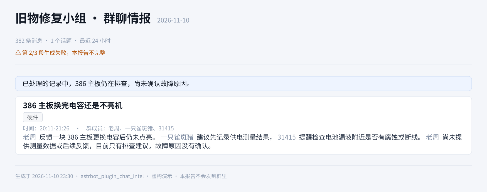

<p align="center">
  
</p>

<h1 align="center">群聊情报（astrbot_plugin_chat_intel）</h1>

<p align="center">按每个群自己的兴趣标签整理聊天，生成报告图，私聊发给你，还能接着查原话、聊细节。</p>

适用于 AstrBot + OneBot v11。机器人加入目标群并持续在线，插件累积收到的消息。
你为每个群填写关心的标签，模型按实际讨论整理话题，再由本地 Typst 排版成图。
报告仅在私聊投递，手动使用权限由 `owner_uids` 控制。

## 安装与首次使用

1. 将仓库放入 AstrBot 的 `data/plugins/`，安装插件依赖后在 WebUI 重载。
2. 在插件设置的 `owner_uids` 填入你自己的 QQ 号。留空时任何人都不能主动生成或查询。
3. 在「要总结的群」添加一行，填写群号、读取账号的平台实例 ID、关心的标签。
4. 确认已配置 AstrBot 默认对话模型，并准备好可用的中文字体。
5. 私聊机器人说「群聊情报，总结今天的考古群」，先验证一份报告。

```bash
cd <AstrBot>/data/plugins
git clone https://github.com/Blue-radish/astrbot_plugin_chat_intel
cd astrbot_plugin_chat_intel
```

若依赖未自动安装，在 **AstrBot 实际运行的 Python 环境**中执行以下命令，然后重载插件。

```bash
python -m pip install -r requirements.txt
```

### 中文字体

模板优先使用 Noto Sans SC，依次回退到 Source Han Sans SC、Microsoft YaHei、PingFang SC、Inter。
Windows / macOS 可使用系统已有的中文字体；缺字体的环境可将 `NotoSansSC.ttf` 等字体放到以下目录。
目录由插件创建，字体文件需要自行准备。

```text
<AstrBot>/data/plugin_data/astrbot_plugin_chat_intel/fonts/
```

中文显示为方框时，检查字体是否存在并重载插件。

## 配置

在 WebUI 的插件设置中填写。先配置群列表和使用权限，需要定时报告时再设置自动推送。

### 每个群单独配置

| 字段 | 怎么填 |
|---|---|
| 群号 `gid` | 必填，机器人需加入该群 |
| 读取账号 `platform` | 必填，AstrBot 平台实例 ID，例如 `bot_b`，用于读取该群历史与群名 |
| 群名备注 `name` | 可选，用于识别群和展示报告标题；留空自动读取群名 |
| 关心的标签 `tags_pos` | 必填，一行一个或逗号分隔，例如「复古硬件维修」「本地模型部署」 |
| 不要的标签 `tags_neg` | 可选，例如「二手交易」「砍价」，由模型按语义排除相关内容 |

缺少读取账号或正向标签的群仍可采集收到的消息，但生成时会跳过并返回原因。
重复群号只采用第一行配置。

每个话题至少匹配一个正向标签，标题按实际讨论生成。
负向内容能剥离时只排除那部分，主体属于负向范围时舍弃整个话题。标签越具体，筛选通常越准确。
报告标题为「群名备注或自动群名 · 全局标题」。`report_title` 留空时只显示群名。

<details>
<summary>直接编辑 JSON 配置</summary>

配置文件为 `data/config/astrbot_plugin_chat_intel_config.json`。
`chats` 中每行需带 `"__template_key": "chat"`，否则 WebUI 无法按模板显示该条目。
在界面点击「添加」会自动生成这个字段。

</details>

### 使用权限与静默账号

- `owner_uids` 填允许主动生成、查看报告和查记录的 QQ 号，一行一个，仅允许私聊使用。
- 留空时拒绝使用，要报告的人会收到配置提示，同一小时最多提示一次。
- `ignore_uids` 填不计入报告的 QQ 号，一行一个，通常填写机器人自己。
- `silence_platforms` 默认为空，一行一个平台实例 ID。填入平台实例 ID 后，该账号在所有群和私聊中的回复都会被拦截，其他插件的回复也受影响，消息仍照常采集。
- 每群的读取账号不会自动静默。双账号使用时，可以让静默账号留在群里采集，由另一账号与你私聊。

### 定时生成与自动推送

| 配置项 | 说明 | 默认 |
|---|---|---|
| `daily_time` | 每天生成时间，使用 AstrBot 运行机器的本地时区，例如 `23:00`；留空关闭定时 | 空 |
| `push_enabled` | 是否把定时生成的报告自动私聊发出 | `false` |
| `push_platform` | 用哪个机器人发，填写平台实例 ID | 空 |
| `push_uid` | 自动收件人的 QQ 号 | 空 |

只想手动使用时，这四项可保持默认。手动报告回复到发起请求的私聊，独立于自动推送开关。
自动收件人由 `push_uid` 决定，使用权限名单不会自动成为收件人。

定时报告每次覆盖触发时刻之前的 **24 小时**（窗口固定，不看上次跑到哪，漏跑一次也不会丢那段）。
生成成功后会把「已读」边界推到报告结尾，所以之后问「最新消息」，只给这之后的新内容；手动指定范围（「总结今天的」）同样算已读。分段失败的那次不推进，下一轮还能补。
例如每天 23:00 生成，范围为昨天 23:00 至今天 23:00。漏跑的日期需要手动指定范围补生成。
关闭自动推送后，定时报告仍会生成并保存在本地。

旧配置的 `push_umo` 仅兼容合法私聊目标，新字段优先。旧值为群聊目标时会停用并提示重新配置收件人。

### 内容、图片与保留期

| 配置项 | 说明 | 默认 |
|---|---|---|
| `days` | 首次增量生成的回溯天数，实际覆盖取决于已采集记录与历史接口 | `1.0` |
| `max_messages` | 单群单次总结的消息上限，超出时取最近一批 | `10000` |
| `use_local_store` | 本地累积收到的群消息，建议保持开启 | `true` |
| `include_images` | 将合适的群图片排入报告 | `true` |
| `max_images` | 每个话题最多配图数，`0` 表示不配图 | `4` |
| `max_image_mb` | 单张下载图片大小上限，单位 MB | `8` |
| `keep_days` | 本地消息、图片和报告的保留天数 | `7` |
| `smart_parse` | 时间或群名规则无法识别时，调用模型辅助解析生成参数 | `true` |
| `report_title` | 报告标题的后半部分 | `群聊情报` |
| `render_ppi` | 报告出图清晰度，数值越大文件通常越大 | `180` |

总结使用 AstrBot 当前默认对话模型。判图优先使用能读图的模型；默认模型不能读图时，尝试其他声明支持图片输入的供应商。
没有可用视觉模型时退回较保守的尺寸和上下文筛选，可能漏掉有用图片。

## 日常怎么用

两种入口，**都不靠关键词猜意图**：

- **自然语言**：直接说话即可。插件把「用户说了什么」交给当前对话模型判断，模型从六个工具里选
  （生成、读报告、查原话、取消、重发、查状态），插件只负责权限、参数校验、执行和如实回执。
  插件自己不做「这句话算不算要报告」的规则判断——词表判不准语义，夸一句「这份群聊情报总结得真好」
  照样能命中。
- **`/群总结 [时间] [群名]`**：确定性入口，给不想赌模型的时候用。校验顺序固定：
  私聊 → 主人 → 群配置 → 参数 → 队列，每一步的拒绝理由都原样回给你。

| 想做什么 | 自然语言示例 | 命令 |
|---|---|---|
| 看新消息 | 「群聊情报，跑一份」 | `/群总结` |
| 看指定群、指定日期 | 「群聊情报，总结今天的考古群」 | `/群总结 今天 考古` |
| 重新生成 | 「群聊情报，重跑昨天的考古群」 | `/群总结 昨天 考古`（再让我重跑一次） |
| 重发已有图片 | 「刚才那份再发我一遍」 | — |
| 看运行情况 | 「群聊情报，现在什么状态」 | — |
| 叫停手动生成 | 「取消这次群聊情报」 | — |
| 讨论报告 | 「刚才那份第二个话题，具体怎么回事？」 | — |
| 查来源 | 「第二个话题里，他原话怎么说的？」 | — |
| 查后续 | 「查最近三天，这个问题后来有人验证了吗？」 | — |

不指定群时，生成范围为所有已配置的群。点名的群无法匹配时会返回提示和可用群列表。
不指定时间时使用增量，首次按 `days` 回溯，之后从该群上次进度继续。
指定「今天」「昨天」「最近3天」「本周」「上周」或具体日期时，汇总指定范围。
给了时间但认不出来（比如 `2026-02-30`、`上个月`）会直接报错并给出可用写法，**不会**悄悄退成
「补一次最新消息」。「重跑」要求重新生成；「重发」发送已有图片。

报告的身份必须显式：读报告、重发都必须带 `report_id`。模型省略 ID 时插件不替你选，而是把候选
（标着哪个「正在讨论中」、哪个是「最近投递」）列回去让它重试——读取会更新讨论焦点，猜错就会把
正在聊的那份换掉。实际读到/发出哪一份，回执里都会写明群和范围。

生成可能需要较长时间。插件先发送范围与目标群的回执，完成后再发图。
忙碌时最多再排两份请求，队列满时会明确拒绝。
取消针对当前会话的手动请求，包含该会话的排队请求。当前版本的取消边界见下方「已知限制」。

### 报告样张

以下内容、群名与成员均为虚构演示，使用当前报告模板与图片排版逻辑生成。

**多话题报告**包含标题、兴趣标签、讨论时间、参与人、正文和对应配图。标题只写群名（或你配的群名备注），**图里不印群号**——报告图常被转发，一张图就等于把「哪个群」交出去；群号只保留在本地报告 JSON 和文字回复里。


**较短的报告**按实际信息量组织内容，保留尚未解决的问题。


**部分生成失败的报告**会在顶部提示缺失的分段。



没有消息、只有图片和表情，或没有命中标签时，手动请求会收到文字说明，该群不生成报告图。
定时任务遇到无内容时仅记录日志。

### 发完报告还能讨论什么

每份报告同时保存图片和 JSON 正文。模型可以读正文、查引用、按关键词浏览已采集的消息。
你可以接着问「这条依据是什么」「说的是亲测还是建议」「后来有没有结果」。

- 群友的猜测、建议、转述与实测应按原有性质保留；没有后续验证时应明确说明。
- 话题时间和参与人由引用的原始消息计算，报告中的概括仍由模型生成。
- 新报告投递成功时更新讨论焦点。讨论指定旧报告时，请说明群、日期或报告 ID。
- 查后续需要覆盖后续时段；仅查询报告引用，只能看到原引用及其附近消息。
- 查询未命中只代表本次范围与可用记录中没找到，不能据此断言从未有人讨论。

<details>
<summary>模型工具的分工</summary>

| 工具 | 用途 |
|---|---|
| `group_digest(when, group, again)` | 提交新报告生成，插件发送回执与最终图片 |
| `get_group_report(report_id, topic_no, gid)` | 读取已保存报告；`topic_no` 从 1 开始，0 为全部话题 |
| `query_group_records(report_id, msg_ids, keyword, gid, when, offset)` | 查原始消息与上下文，每页最多 20 条命中，按返回的 `offset` 翻页 |
| `cancel_digest()` | 取消当前会话的手动生成请求 |

查原话时同时传 `report_id` 与 `msg_ids`，默认使用报告的群和时间范围。
查后续时保留 `report_id` 定位群，传更大的 `when` 范围，清空 `msg_ids` 并改用关键词。
关键词按任意一个匹配；引用优先于关键词。两者都留空时浏览指定范围，从最近一页开始。
查询单群最多扫描最近 50000 条，达到上限会提示覆盖限制。

</details>

## 图片处理

收到群消息后，插件会尝试下载图片到本地，降低临时链接过期造成的影响。
报告只从话题引用的消息中选图，视觉判断结合该群的标签和话题，保留提供额外信息的截图、图表、照片等。
判定结果按兴趣配置、话题和图片缓存。

图片按像素尺寸与可用宽度计算显示大小。过高的竖图会切成 2–3 段横排，切点优先落在空白行，找不到合适空白时保留少量重叠。
这能减少过度缩小与截断文字的情况，阅读体验仍受原图清晰度和报告显示尺寸影响。

## 数据、隐私与覆盖范围

本地数据保存在以下目录，超过 `keep_days` 的数据会在启动和生成后清理。

```text
data/plugin_data/astrbot_plugin_chat_intel/
├── messages/YYYY-MM-DD.jsonl   # 原始消息
├── images/YYYY-MM-DD/          # 已下载图片
├── reports/chat_intel_*.png    # 报告图
├── reports/chat_intel_*.json   # 报告正文与来源引用
├── fonts/                     # 自行放入的字体
└── state.json                 # 增量进度、报告索引、讨论焦点和判图缓存
```

**模型调用会把聊天文本发送给所配置的模型供应商，视觉判图还会发送候选图片及上下文。**
图片在本地排版。请在具备相应授权的群中使用，并根据需要选择模型服务与保留期。
主动生成和查询仅允许 `owner_uids` 中的用户私聊使用；自动推送按单独配置的收件人发送。

多数 OneBot 历史接口一次只能补取最近约 200 条，具体能力取决于实现。
首次安装前、离线期间的记录可能不完整；新收到的消息会随在线时间逐步积累。
`days` 增大不能恢复未采集且历史接口也无法取回的消息。

## 已知限制

- 依赖 OneBot v11 的群历史和群信息接口，以及机器人在目标群中的在线状态。
- 自然语言入口完全交给对话模型：插件不判断「这句话算不算要报告」。代价是模型的判断力和稳定性
  就是这个功能的天花板——实测里它偶尔会漏给 `report_id`（此时插件拒绝并回候选，需要多一轮）
  或选错工具。插件保证的是：**不猜身份、不悄悄换焦点、错也让你看得见**（回执写明份数、群、范围）。
  想要确定性就用 `/群总结`。
- 取消功能当前仍存在否定句误触、取消后的队列接续和定时接续请求的边界问题。
- 当前取消记录在报告索引中仍可能显示为「生成失败（已取消）」。
- 长记录按约 55000 字符分段处理。部分分段失败时会在报告顶部标明不完整，并保留增量进度以便重试。
- 单群单次超过 `max_messages` 时仅处理最近一批，报告中的消息数为本次实际处理数量。
- 旧版本只有图片的报告无法直接读取正文，需要重新生成后才能讨论细节。
- 模型可能遗漏或误解内容，关键结论可通过原始消息查询核对。

## 目录结构

```text
main.py             # 插件入口与功能实现
metadata.yaml       # 插件名称、版本和兼容信息
_conf_schema.json   # WebUI 配置项
logo.png            # AstrBot 图标，256×256
README.md           # 安装、配置与使用
CHANGELOG.md        # 版本变更
docs/               # README 图片，logo 为 200×200
scripts/            # 资源维护脚本
tests/              # 离线测试
```

群聊总结另有 `interest.py`、`intent.py`、`imaging.py`、`reports.py`，分别处理兴趣、提示锚点（仅用于
「没配主人」这类配置提示）、配图和报告存档。`tools/model_accept.py` 是真实模型验收脚本（不属于测试
套件，需要本机配置好的对话模型），用来逐条核对「自然语言 → 工具 → 后端结果」是否符合标注。
`templates/` 保存报告模板。

## 开发

在装有 AstrBot 项目依赖、pytest 和插件依赖的 Python 环境中运行测试，测试使用伪事件与伪模型。

```bash
python -m pytest tests -q
```

使用虚构数据离线重绘样张，`--fonts` 指向可用的字体目录。

```bash
python scripts/render_assets.py --fonts <字体目录> --scene full
python scripts/render_assets.py --fonts <字体目录> --scene light
python scripts/render_assets.py --fonts <字体目录> --scene incomplete
```

更新图标时，在装有 Pillow 的开发环境中运行以下命令。

```bash
python scripts/sync_logo.py --source <原始透明PNG>
```

脚本生成根目录的 256×256 插件图标和 `docs/logo.png` 的 200×200 README 小图。
README 以 200px 显示。两张图使用同一设计，按用途保存不同尺寸。

## License

MIT
