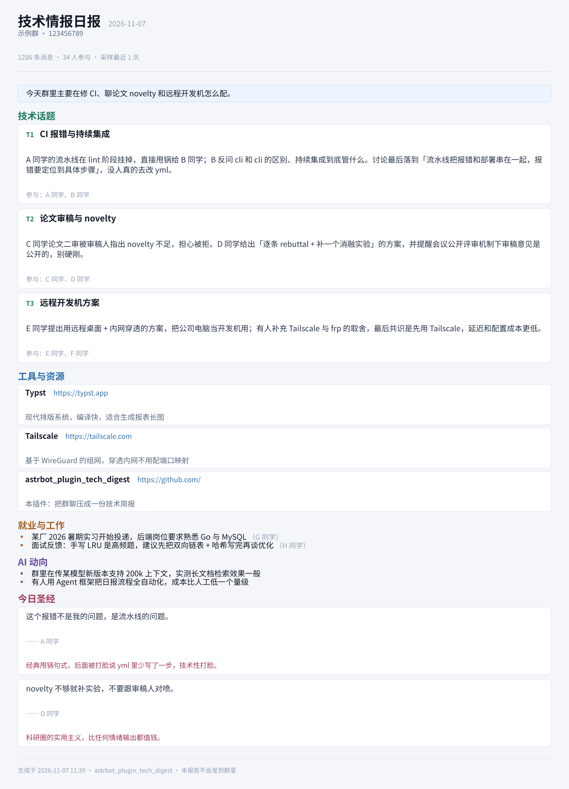

# 技术情报日报（astrbot_plugin_tech_digest）

把群聊压成一份**只留技术向内容**的情报简报，在本地排版成一张长图，私聊发给你。

面向的读者是计算机专业的学生 / 从业者：只关心 **计算机与编程、AI、软件与工具、有意思的网站与资源、工作与就业**，
吃饭、游戏、情感、追星、地域争吵、纯玩梗复读一律不进报告。



## 它做什么

1. **拉消息**：用指定 AstrBot 平台的 OneBot 适配器读取群历史；机器人常驻时同时把每条群消息落盘累积（见「为什么要本地累积」）
2. **抽取**：一次 LLM 调用，输出结构化 JSON——技术话题 / 工具与资源 / 就业与工作 / AI 动向 / 今日圣经
3. **排版**：本地 [Typst](https://typst.app) 编译成一张长图，不依赖任何远程渲染服务（不烧 GPU、不需要浏览器、断网也能出图）
4. **投递**：图片写入插件数据目录，**永不发回群里**；到点自动私聊推送，或用命令随时生成
5. **静默通道**（可选）：让承载它的机器人账号在任何群、任何私聊里都不开口——用「只读机器人号挂着群」时不会暴露

## 安装

### 1. 插件本体

把本仓库放到 AstrBot 的插件目录：

```bash
cd <AstrBot>/data/plugins
git clone https://github.com/<you>/astrbot_plugin_tech_digest
```

然后在 WebUI 的「插件管理」里重载，或在配置里启用。

### 2. 依赖

```bash
pip install typst
```

Typst 是本地排版引擎，`pip install` 即可，无需额外运行时（不依赖浏览器、不依赖 LaTeX）。

### 3. 中文字体

报告模板优先使用 **Noto Sans SC**。把字体文件放进：

```
<AstrBot>/data/plugin_data/astrbot_plugin_tech_digest/fonts/
```

至少放一个中文字体（`NotoSansSC.ttf` 或任何 `Source Han Sans` / `Microsoft YaHei` 均可），
否则中文会显示成方框。模板的字体回退顺序是：
`Noto Sans SC → Source Han Sans SC → Microsoft YaHei → PingFang SC → Inter`，
所以 Windows / macOS 上即使不装 Noto 也能正常显示。

## 配置

在 WebUI 的插件配置页填写（也可以直接改 `data/config/astrbot_plugin_tech_digest_config.json`）：

| 配置项 | 说明 | 默认 |
|---|---|---|
| `group_id` | 要总结的群号（必填） | 空 |
| `platform_id` | 用哪个平台实例去拉消息，该账号必须在群里 | 空 |
| `group_name` | 群名，留空则自动获取 | 空 |
| `days` | 回溯多少天 | `1.0` |
| `max_messages` | 单次最多处理多少条 | `1500` |
| `use_local_store` | 本地累积群消息 | `true` |
| `daily_time` | 每天自动生成时间 `HH:MM`，留空则不定时 | `23:00` |
| `push_enabled` | 生成后自动私聊推送 | `false` |
| `push_umo` | 推送目标会话 `<平台id>:FriendMessage:<QQ号>` | 空 |
| `provider_id` | 指定模型供应商，留空用默认 | 空 |
| `keep_quotes` | 是否保留「今日圣经」板块 | `true` |
| `report_title` | 报告标题 | `技术情报日报` |
| `render_ppi` | 出图清晰度 | `180` |
| `ignore_uids` | 不统计的 QQ 号（一般填机器人自己） | 空 |
| `silence_platforms` | 静默平台，逗号分隔；留空则静默 `platform_id` | 空 |
| `font_dir` | 字体目录，留空用插件数据目录下的 `fonts/` | 空 |

`push_umo` 的格式是 `<平台实例id>:FriendMessage:<QQ号>`，比如机器人平台实例叫 `mybot`、你的 QQ 是 `10001`，
就填 `mybot:FriendMessage:10001`。想推到某个群则用 `GroupMessage:<群号>`——但**不建议**，那等于把报告发群里。

## 命令

| 命令 | 作用 |
|---|---|
| `/techdigest`（别名 `/技术日报`） | 立刻生成一份，发到当前会话 |
| `/techdigest last` | 重发最近生成的一份 |

## 为什么要「本地累积」

多数 OneBot 实现（NapCat / SnowLuma 等）的 `get_group_msg_history` 一次只返回最近约 200 条，且
`message_seq` 参数不一定支持翻页——想要覆盖一整天，靠历史接口是不够的。

所以本插件在静默通道里顺手把目标群的每条消息写到
`data/plugin_data/astrbot_plugin_tech_digest/messages/YYYY-MM-DD.jsonl`，
生成时把「本地库 + 历史接口兜底」合并去重。机器人 24 小时在线，就能拿到完整一天的聊天。

代价是：**首次安装的当天只能覆盖最近 200 条**，第二天起才是完整一天。

## 隐私与安全

- 报告**只落盘 + 私聊投递**，代码里没有任何「发回被总结的群」的路径
- 静默通道三层拦截（事件终止 / LLM 请求拦截 / 回复内容清空），避免机器人账号在群里说话
- 消息库只存文本与你配置的群，路径在插件自己的数据目录，删目录即清空

## 已知限制

- 需要机器人账号**在目标群里且长期在线**，离线期间的消息只能靠 200 条历史兜底补
- 依赖 OneBot v11 实现提供的 `get_group_msg_history` / `get_group_info`
- 报告质量取决于所配模型的结构化输出能力，建议用支持长上下文的模型

## 开发

```bash
# 用示例数据渲染一张样张（不连 AstrBot，不需要模型）
python scripts/preview.py --out docs/screenshot.png --fonts ./fonts
```

代码结构：

```
main.py              # 插件主逻辑：拉消息 / 抽取 / 排版 / 投递 / 静默通道
templates/report.typ # Typst 排版模板，数据由同目录 data.json 提供
scripts/preview.py   # 用示例数据出样张
_conf_schema.json    # WebUI 配置项定义
```

## License

MIT
